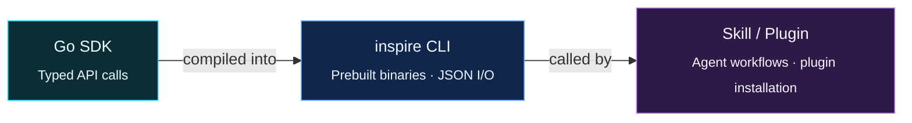

<div align="center">

# Inspire Go SDK

**Go SDK → CLI → Skill / Plugin**

<sub>The Inspire computing platform, from typed API calls to agent workflows.</sub>

<br>


[Releases](https://github.com/Lixsp11/inspire-go-sdk/releases) · [Skill](skills/inspire-go-sdk/SKILL.md) · [Plugin](plugin.json)

</div>

---



## Install

With a Codex CLI that supports plugins:

```shell
codex plugin marketplace add Lixsp11/inspire-go-sdk --ref v0.2.0
codex plugin add inspire-go-sdk@inspire-go-sdk
```

Start a new Codex session and ask it to use **Inspire Go SDK**.

The plugin bundles the skill; the skill runs the prebuilt CLI; the CLI calls the Go SDK. The matching binary is downloaded and SHA256-verified on first use. **No Go installation is required.**

Set `INSPIRE_COOKIE` to your existing management session and `INSPIRE_PROXY` to your proxy URL when needed.

## Tech stack

| | |
| --- | --- |
| **SDK** | **Go 1.23+**, typed requests and responses, `context` |
| **CLI** | Prebuilt **`inspire`**, JSON output, profiles, pagination and job waiters |
| **Skill / Plugin** | CLI workflows for agents, bundled launchers and plugin installation |
| **Transport** | **net/http**, **encoding/json**, HTTP and SOCKS5 proxies |
| **Testing** | **testing**, **httptest**, race detector |
| **Shipping** | **GitHub Actions**, Windows / Linux / macOS, amd64 / arm64 |
